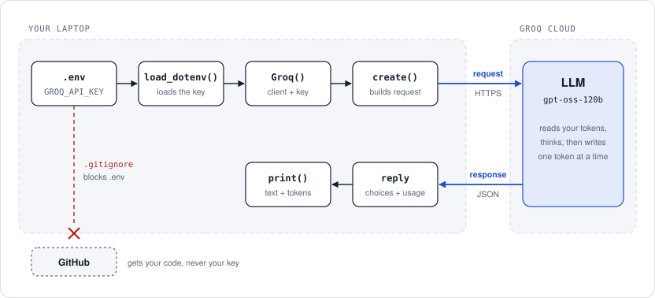

# Day 1 revision: make one call

**In one line:** your Python script sends text to a model on Groq's servers and gets text back. The API key proves it is you. It lives in `.env`, never in your code.

## The flow



1. `load_dotenv()` reads `.env` and loads `GROQ_API_KEY`.
2. `Groq()` creates the client. It finds the key by itself.
3. `create()` sends one request over HTTPS with the model name, your messages and `max_tokens`.
4. The model on Groq's servers reads your tokens, thinks, then writes the reply one token at a time.
5. The response comes back as a `reply` object. You read two things from it: the text and the token counts.
6. `.gitignore` lists `.env`, so GitHub gets your code but never your key.

## Key ideas

| Term | Meaning |
|---|---|
| LLM | A model that predicts the next token again and again until the reply is finished. |
| API | A way for your code to use someone else's program. You send a request and get a response. |
| API key | Your password for the API. Anyone who has it can use your quota. |
| `.env` + `load_dotenv()` | The key lives in `.env`. `load_dotenv()` loads it, and `Groq()` finds `GROQ_API_KEY` on its own. |
| `.gitignore` | Files Git never uploads. Yours lists `.env`, `venv/` and `__pycache__/`. |
| venv | A private set of packages for this project. Activate it first; the terminal line then starts with `(venv)`. |
| Token | A chunk of text, roughly ¾ of a word. You pay for tokens in and tokens out. |
| `max_tokens` | The longest the reply may be. Set it too low and the answer is cut off. |

## Code to remember

```python
from dotenv import load_dotenv
from groq import Groq

load_dotenv()                # .env → environment
client = Groq()              # finds GROQ_API_KEY by itself

reply = client.chat.completions.create(
    model="openai/gpt-oss-120b",
    max_tokens=300,
    messages=[{"role": "user", "content": "Explain the rules of cricket in 3 simple lines."}],
)

print(reply.choices[0].message.content)                           # the answer
print(reply.usage.prompt_tokens, reply.usage.completion_tokens)   # tokens in, tokens out
```

On Windows, keep `sys.stdout.reconfigure(encoding="utf-8")` at the top so the terminal can print any character the model sends.

### Reading the reply

| Code | Gives you |
|---|---|
| `reply.choices[0].message.content` | The answer text |
| `reply.usage.prompt_tokens` | Tokens you sent |
| `reply.usage.completion_tokens` | Tokens the model wrote, hidden reasoning included |

## If it breaks

| You see | Fix |
|---|---|
| `401 authentication_error` | The key in `.env` is incomplete or wrapped in quotes. |
| `429` rate limit | Free-tier limit. Wait a minute and retry. |
| model not found | Copy a current model name from console.groq.com/docs/models. |
| `No module named 'groq'` | Activate the venv first. |
| `UnicodeEncodeError` | Keep the `sys.stdout.reconfigure` line. |

## Recall check

Answer out loud first, then click to check.

<details>
<summary><b>Q1.</b> Why does the key go in <code>.env</code> and not in <code>first.py</code>?</summary>

Your code goes to GitHub. `.env` is listed in `.gitignore`, so the key never leaves your laptop. If a key ever leaks, delete it in the Groq console and create a new one.

</details>

<details>
<summary><b>Q2.</b> What do <code>prompt_tokens</code> and <code>completion_tokens</code> count?</summary>

`prompt_tokens` is everything you sent. `completion_tokens` is everything the model wrote, including its hidden reasoning. You pay for both.

</details>

<details>
<summary><b>Q3.</b> Why <code>reply.choices[0].message.content</code> instead of just <code>reply</code>?</summary>

`reply` is an object full of metadata. `choices` is a list of answers (normally one), `[0]` takes the first, and `.message.content` is its text.

</details>

<details>
<summary><b>Q4.</b> You installed <code>groq</code>, but Python says <code>No module named 'groq'</code>. Why?</summary>

The venv is not active, so Python looks in the global packages. Run `venv\Scripts\activate` and check that `(venv)` appears.

</details>

## Say it in one line

- An LLM predicts the next token, again and again, until the reply is done.
- The key lives in `.env`, and `.gitignore` keeps it off GitHub.
- No `(venv)` in the terminal means no `groq` module.
- `choices[0].message.content` is the answer, and `usage` is the bill.

---

Next: [Day 2 revision](../Day-02/revision_notes.md)
