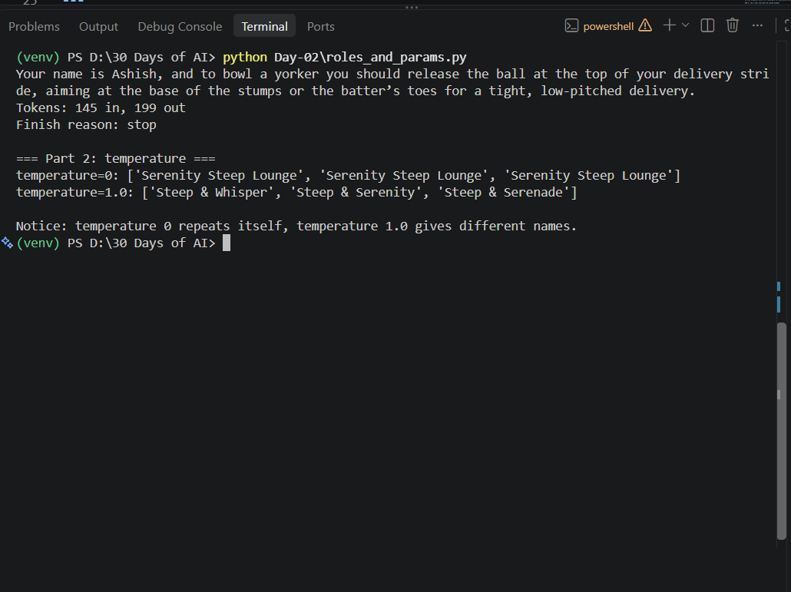
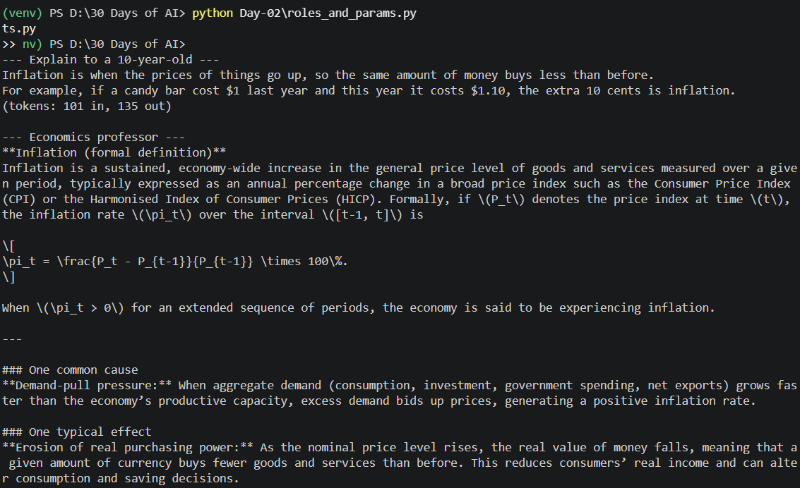
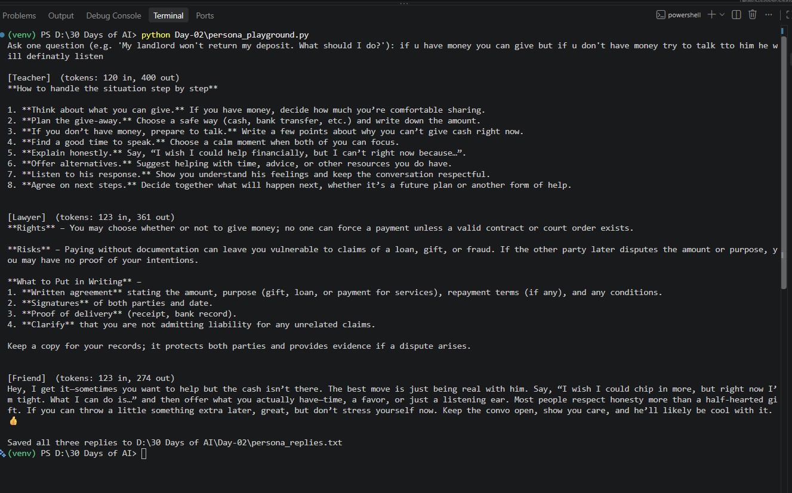

# Day 2: Messages, system prompts, parameters

**Learn:** roles (system/user/assistant), max_tokens, temperature and tokens.
**Build:** a notes file comparing 3 system prompts.
**Real project:** Persona playground, which asks one question as a teacher, a lawyer and a friend and saves all three replies to a text file.

## Files
| File | What it does |
|---|---|
| `roles_and_params.py` | Shows the 3 roles in one conversation, then asks the same question 3 times at temperature 0 and at 1.0 |
| `system_prompts.py` | **Build:** asks the same question under 3 system prompts and saves the answers to `system_prompt_comparison.md` |
| `persona_playground.py` | **Real project:** you type one question; it answers as Teacher, Lawyer and Friend and adds the replies to `persona_replies.txt` |
| `interview_questions.md` | Interview questions on today's topics |
| `revision_notes.md` | Revision notes: flow diagram, your real numbers and a recall quiz |
| `screenshots/` | Proof that the scripts ran (see [Output](#output-proof-it-works)) |

## Already done
- [x] Day 1 setup works (Python, `venv/`, `groq`, `python-dotenv`, `.env` with the Groq key)
- [x] No new libraries needed today

## Steps to run
1. Open the main folder `30 Days of AI` in VS Code, then choose **Terminal > New Terminal**.
2. Activate the virtual environment. You should then see `(venv)` at the start of the line:
   ```powershell
   venv\Scripts\activate
   ```
   If you see "running scripts is disabled", run `Set-ExecutionPolicy -Scope CurrentUser RemoteSigned` and try again.
3. **Learn the roles and temperature** (run this first):
   ```powershell
   python Day-02\roles_and_params.py
   ```
   You should see:
   - **Part 1:** the model says your name and explains how to bowl a yorker. It knows your name only because the earlier messages are sent again.
   - **Part 2:** temperature 0 prints the same tea-shop name 3 times; temperature 1.0 prints 3 different names.
4. **Run the build** (system prompts):
   ```powershell
   python Day-02\system_prompts.py
   ```
   You should see "What is inflation?" answered 3 ways (for a 10-year-old, as a professor, in one line) with token counts, then `Saved to ...system_prompt_comparison.md`.
   Open `Day-02\system_prompt_comparison.md` and fill in the **My notes** section at the bottom.
5. **Run the real project** (persona playground):
   ```powershell
   python Day-02\persona_playground.py
   ```
   Type a question and press Enter. You get 3 replies (Teacher, Lawyer, Friend), and they are added to `Day-02\persona_replies.txt`.

Run one command at a time, and wait for `(venv) PS ...>` to come back before typing the next.

## Output (proof it works)

**`roles_and_params.py`:** the model remembers the name "Ashish" from earlier in the conversation. Temperature 0 repeats "Serenity Steep Lounge"; 1.0 gives 3 different names.



**`system_prompts.py`:** the same question, "What is inflation?", gets a simple answer with an example for a 10-year-old (135 output tokens) and a formal answer with a formula, cause and effect from the professor.



**`persona_playground.py`:** one question, three personas. The Teacher gives numbered steps, the Lawyer covers rights, risks and what to put in writing, and the Friend talks casually. All three replies are saved to `persona_replies.txt`.



## Key ideas
- **system** = how to behave, **user** = you, **assistant** = the model's earlier replies.
- The model has **no memory**. To continue a chat, you send the whole conversation again.
- **temperature** 0 = steady and repeatable (use it for facts and extraction). Around 1 = creative and varied.
- **max_tokens** = the longest one reply can be. `finish_reason == "length"` means the reply was cut off.
- **Hidden reasoning tokens:** `gpt-oss-120b` thinks before it answers, and that thinking counts as output tokens. A one-sentence answer can still cost about 100 tokens.

## Your turn (10 minutes)
1. In `system_prompts.py`, change `QUESTION` and add a 4th system prompt (for example "Answer like a pirate").
2. In `persona_playground.py`, add your own persona to `PERSONAS` (for example "Doctor" or "Strict father").
3. In `roles_and_params.py`, change the user's name and remove the `assistant` message. Does the model still know what a yorker is?
4. Set `max_tokens=150` in `system_prompts.py`. Which answer gets cut off or comes back empty? Why?

## If something breaks
| Error | Fix |
|---|---|
| `UnicodeEncodeError: 'charmap'` | Keep the `sys.stdout.reconfigure(encoding="utf-8")` line at the top of the script |
| Empty answer | `max_tokens` is too small; the model used it all on hidden reasoning. Raise it |
| rate limit (429) | You made many calls quickly on the free tier. Wait a minute and retry |
| `authentication_error` / 401 | Check the key in `.env` |
| Strange text like `ts.py >> nv)` in the terminal | Two commands were pasted together. Press Enter, wait for the prompt, then run one command at a time |

## Notes
Write what you learned here:
-
