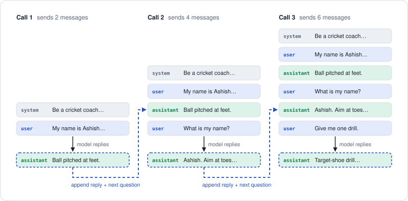

# Day 2 revision: control what goes in

**In one line:** a call carries a list of messages, and each message has a role. The model remembers nothing between calls. To continue a chat, you send the whole conversation again.

## Three roles

| Role | Written by | Tells the model |
|---|---|---|
| `system` | You, the developer | How to behave: persona, rules, length |
| `user` | The person asking | What to answer |
| `assistant` | The model, earlier | What it already said, sent back so it can "remember" |

A persona is just a system prompt. `persona_playground.py` asks the same question under three of them.

## The flow: no memory, so send everything



1. Call 1 sends the system message and your first question.
2. You append the model's reply (an `assistant` message) and your next question.
3. Call 2 sends all 4 messages. This is Part 1 of your `roles_and_params.py`. The model said "Your name is Ashish" only because the first question and answer were sent again (145 tokens in, 199 out).
4. Every turn re-sends the whole history, so input tokens grow every turn. On Day 4 your code builds this list for you.

## Same question, different system prompt

From your `system_prompt_comparison.md` ("What is inflation?", temperature 0):

| System prompt | Tokens in | Tokens out | Output size |
|---|---:|---:|---|
| Explain to a 10-year-old | 101 | 135 | ███████ |
| Economics professor | 98 | 402 | ████████████████████ |
| One-line answers only | 89 | 117 | ██████ |

Only the system prompt changed, and length, tone and cost all followed it. The one-line answer still used 117 output tokens, because `gpt-oss-120b` reasons privately before it answers and that hidden reasoning is billed as output.

## Temperature

Your run of "Give me one creative name for a tea shop.", asked 3 times at each setting:

| Setting | The 3 answers |
|---|---|
| `temperature=0` | Serenity Steep Lounge · Serenity Steep Lounge · Serenity Steep Lounge |
| `temperature=1.0` | Steep & Whisper · Steep & Serenity · Steep & Serenade |

Use **0** when you want the same correct answer every time: facts, extraction and all of Day 3. Use **0.7 to 1.0** for variety. Your `persona_playground.py` uses 0.7 so the personas sound natural.

## max_tokens and finish_reason

`max_tokens` is one budget shared by hidden reasoning and the visible answer.

| `max_tokens` | Hidden reasoning | Visible answer | `finish_reason` | What you get |
|---|---:|---:|---|---|
| 800 (example split) | 280 | 120 | `"stop"` | The full answer |
| 40 (your Day 1 test) | 40 | 0 | `"length"` | An empty answer |

If reasoning uses the whole budget, `content` is empty and `finish_reason` is `"length"`. The fix is to raise `max_tokens`.

## Code to remember

```python
messages = [
    {"role": "system",    "content": "You are a cricket coach. Keep every answer under 2 sentences."},
    {"role": "user",      "content": "My name is Ashish. What is a yorker?"},
    {"role": "assistant", "content": "A yorker is a ball pitched right at the batter's feet..."},
    {"role": "user",      "content": "What is my name, and how do I bowl that ball?"},
]

reply = client.chat.completions.create(
    model=MODEL,
    messages=messages,     # the WHOLE history, every time
    max_tokens=500,        # shared by reasoning + answer
    temperature=0,         # 0 = steady, 1.0 = varied
)
print(reply.choices[0].finish_reason)   # "stop" = finished, "length" = cut off
```

## Recall check

Answer out loud first, then click to check.

<details>
<summary><b>Q1.</b> How did the model know your name in Part 1?</summary>

It did not remember anything. The earlier question and answer were sent again inside the same call.

</details>

<details>
<summary><b>Q2.</b> One question, three system prompts. What changed?</summary>

Length, tone, structure and cost (135, 402 and 117 output tokens). The question stayed the same.

</details>

<details>
<summary><b>Q3.</b> When do you use temperature 0?</summary>

When you want the same correct answer every time: facts, extraction and JSON. All of Day 3 runs at 0.

</details>

<details>
<summary><b>Q4.</b> The reply is empty and <code>finish_reason</code> is <code>"length"</code>. What happened?</summary>

The model spent the whole `max_tokens` budget on hidden reasoning before it wrote any answer. Raise `max_tokens`.

</details>

<details>
<summary><b>Q5.</b> Can you write an <code>assistant</code> message yourself?</summary>

Yes. The model treats it as something it said earlier. Day 3 uses this for few-shot examples.

</details>

## Say it in one line

- system says how, user says what, assistant is what the model already said.
- The model has no memory. Every call carries the whole history.
- A longer history means more input tokens on every call.
- Temperature 0 for facts and JSON, 0.7 to 1.0 for creative work.
- `finish_reason == "length"` means cut off. Raise `max_tokens`.
- gpt-oss reasons before it answers, and those hidden tokens count as output.

---

Previous: [Day 1 revision](../Day-01/revision_notes.md) · Next: [Day 3 revision](../Day-03/revision_notes.md)
