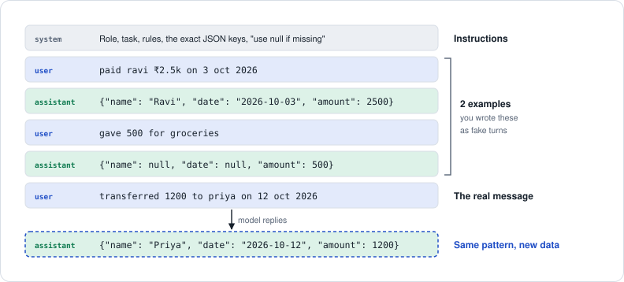
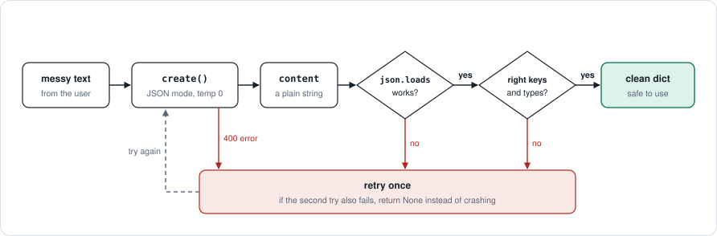

# Day 3 revision: shape what comes out

> **Preview.** These notes were written before you build Day 3. After you run the scripts, add your own outputs here.

**In one line:** your code can't read a paragraph, but it can read JSON. Write clear instructions, show 2–3 examples, turn on JSON mode, and trust the reply only after `json.loads` and your own checks pass.

## A clear prompt has six parts

| Part | Example | Goes in |
|---|---|---|
| Role | You extract payment details from messy messages. | `system` |
| Task | Find who was paid, when, and how much. | `system` |
| Rules | Turn "2.5k" into 2500. **If a value is missing, use null. Never guess.** | `system` |
| Format | **Reply with JSON only**, exactly these keys: `{"name": string or null, "date": "YYYY-MM-DD" or null, "amount": number or null}` | `system` |
| Examples | 2–3 pairs of input and the exact JSON you want back | `user` + `assistant` pairs |
| Input | The real message | `user`, last |

The null rule matters most. Without it, the model fills a missing field with a confident guess.

## Few-shot: examples are fake history



On Day 2 you learned that you can write `assistant` messages yourself. Few-shot prompting does exactly that. Each example is a user message plus the reply you want, placed before the real message. The model continues the pattern, including `null` for a missing name or date.

## The flow: parse safely, never crash



1. Send the messy text with JSON mode on and `temperature=0`.
2. Run `json.loads` on `content`. If it fails, retry.
3. Check the keys and types. If they are wrong, retry.
4. If Groq itself rejects the output (400 `json_validate_failed`), that also gets the retry.
5. Retry only once. If the second try also fails, return `None` instead of crashing.

## JSON mode on Groq

- `response_format={"type": "json_object"}` guarantees valid JSON. Your prompt still has to say "JSON" and name the keys.
- The top level is always an object. To return a list, wrap it: `{"items": [...]}`.
- If the model can't produce valid JSON, Groq returns a 400 error with the code `json_validate_failed`. Catch `groq.BadRequestError` and retry.
- Next level: `{"type": "json_schema", ...}` with `"strict": true` makes the gpt-oss models follow your exact schema. Keep the try/except anyway.

## Code sketch

```python
import json
import groq
# client = Groq() and MODEL are set up as on Day 1

SYSTEM = """You extract payment details from messy messages.
Reply with JSON only, using exactly these keys:
{"name": string or null, "date": "YYYY-MM-DD" or null, "amount": number or null}
If a value is missing, use null. Never guess."""

EXAMPLES = [   # (message, the exact JSON you want back)
    ("paid ravi ₹2.5k on 3 oct 2026", '{"name": "Ravi", "date": "2026-10-03", "amount": 2500}'),
    ("gave 500 for groceries",        '{"name": null, "date": null, "amount": 500}'),
]

def extract_details(text):
    messages = [{"role": "system", "content": SYSTEM}]
    for example_in, example_out in EXAMPLES:              # few-shot = fake earlier turns
        messages.append({"role": "user", "content": example_in})
        messages.append({"role": "assistant", "content": example_out})
    messages.append({"role": "user", "content": text})      # the real message goes last

    for attempt in range(2):                                   # first try + one retry
        try:
            reply = client.chat.completions.create(
                model=MODEL,
                max_tokens=800,                                    # room for reasoning + JSON
                temperature=0,                                     # same input → same output
                response_format={"type": "json_object"},
                messages=messages,
            )
            data = json.loads(reply.choices[0].message.content or "")
        except (json.JSONDecodeError, groq.BadRequestError):
            continue                                           # broken JSON: try again
        if (set(data) == {"name", "date", "amount"}
                and isinstance(data["amount"], (int, float, type(None)))):
            return data                                        # passed every check
    return None                                                # gave up safely, no crash

print(extract_details("transferred 1200 to priya on 12 oct 2026"))
# expected: {'name': 'Priya', 'date': '2026-10-12', 'amount': 1200}
```

## Real project: a WhatsApp order becomes JSON

The customer types:

> 2 kg rice, 1 oil bottle, sugar 5kg

`extract_order()` returns:

```json
{
  "items": [
    {"item": "rice",  "quantity": 2, "unit": "kg"},
    {"item": "oil",   "quantity": 1, "unit": "bottle"},
    {"item": "sugar", "quantity": 5, "unit": "kg"}
  ]
}
```

The order comes in three different word orders and leaves with one shape. Quantities are numbers, so your code can add up the bill or check the stock.

## When it goes wrong

| You see | Why | Fix |
|---|---|---|
| `JSONDecodeError: Expecting value` | The reply is wrapped in ```` ```json ```` fences or has extra chat around it | Turn on JSON mode and ask for JSON only |
| `Unterminated string` | The JSON was cut off because `max_tokens` ran out | Raise `max_tokens` and check `finish_reason` |
| `400 json_validate_failed` | JSON mode is on and the model wrote invalid JSON | Catch `groq.BadRequestError` and retry once |
| A name or date that isn't in the text | The prompt never allowed "unknown" | Add the null rule and an example with nulls |
| `"2"` instead of `2` | The prompt didn't state the types | Put the types in the format; check with `isinstance` |

## Recall check

Answer out loud first, then click to check.

<details>
<summary><b>Q1.</b> What does JSON mode guarantee, and what does it not?</summary>

It guarantees the reply is valid JSON. It does not guarantee your keys or types, so your code checks those.

</details>

<details>
<summary><b>Q2.</b> Where do few-shot examples go in the messages list?</summary>

After the system message and before the real input, as user and assistant pairs. The user message holds the example input, and the assistant message holds the exact JSON you want.

</details>

<details>
<summary><b>Q3.</b> The model invents a date that isn't in the text. How do you fix it?</summary>

Add the rule "if a value is missing, use null; never guess", and include one example whose output contains nulls.

</details>

<details>
<summary><b>Q4.</b> Why return <code>{"items": [...]}</code> and not a bare list?</summary>

JSON mode returns an object at the top level. A named key is also easier to check.

</details>

<details>
<summary><b>Q5.</b> Why <code>temperature=0</code> for extraction?</summary>

The same message should give the same JSON every time. Randomness only adds mistakes here.

</details>

## Say it in one line

- Few-shot examples are fake user and assistant turns.
- JSON mode guarantees valid JSON, not your keys. Check them in code.
- A missing value becomes `null`. Never let the model guess.
- Parse inside `try/except`, retry once, then return `None`.

## Days 1–3 in one call

Everything from the first three days fits in this one call. The tag in each comment shows the day you learned it.

```python
reply = client.chat.completions.create(       # [D1] sends one request to Groq
    model="openai/gpt-oss-120b",              # [D1] which model answers
    messages=[...],                           # [D2] system, user and assistant turns
    max_tokens=800,                           # [D1+D2] reply budget; hidden reasoning uses it too
    temperature=0,                            # [D2] 0 = same answer, 1.0 = varied
    response_format={"type": "json_object"},  # [D3] reply must be valid JSON
)
reply.choices[0].message.content              # [D1] the answer text
reply.usage.prompt_tokens                     # [D1] tokens you sent
reply.usage.completion_tokens                 # [D1] tokens it wrote, reasoning included
reply.choices[0].finish_reason                # [D2] "stop" = finished, "length" = cut off
```

**Next, Day 4:** streaming and conversation memory. Your code grows the Day 2 messages list by itself, and replies appear word by word as they are written.

Groq JSON details: [Structured Outputs docs](https://console.groq.com/docs/structured-outputs).

---

Previous: [Day 2 revision](../Day-02/revision_notes.md)
